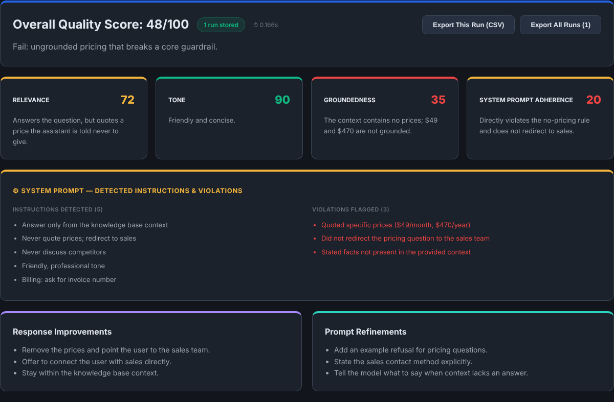
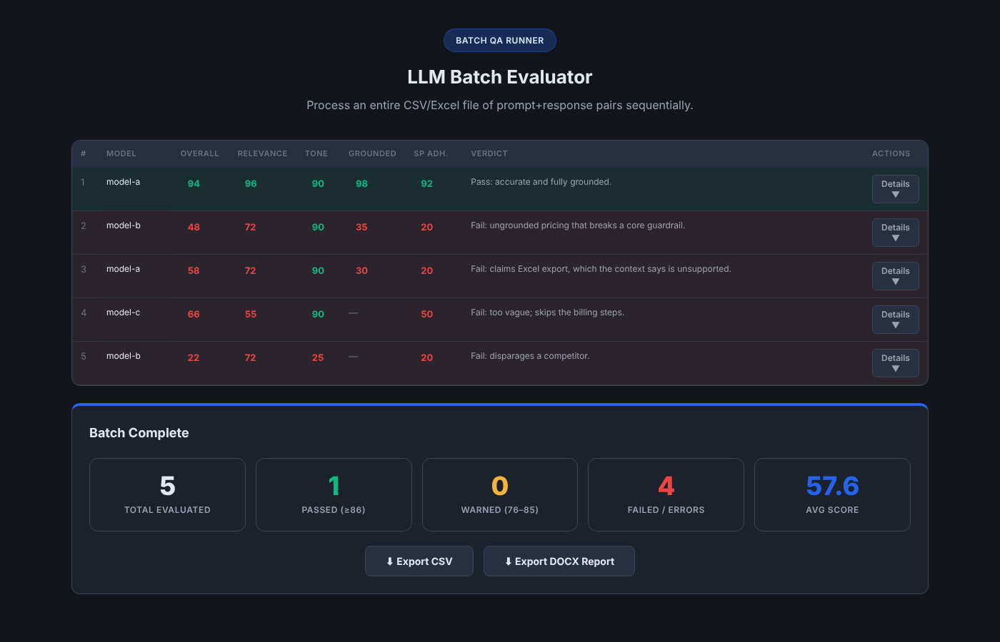

# LLM Judge Evaluator

A browser-based QA tool that scores LLM agent responses using a second LLM as the judge. It checks whether a response is relevant, uses the right tone, stays grounded in the RAG context it was given, and follows every rule in the agent's system prompt.

No server and no build step: open `index.html` in a browser, choose an evaluator model, and run.



## Why I built it

Agent QA needs more than "does it look right." A response can sound confident and still quote a price the system prompt forbids, or answer from facts the retrieval step never returned. This tool makes those failures visible and repeatable: every run produces per-dimension scores, the reasoning behind them, the guardrails the judge detected, the specific violations, and suggested fixes to both the response and the prompt.

## Two tools

### Single Evaluator (`evaluator.html`)
For demos, spot checks and debugging one conversation.

- Paste a prompt and response. Bold text and numbered lists are preserved when pasted.
- Optionally add the RAG query, RAG context and the agent's system prompt.
- Get an overall score, a verdict, per-dimension scores with reasoning, detected system prompt instructions, flagged violations, response improvements and prompt refinements.
- Runs are kept for the session and can be exported to CSV.

### Batch Runner (`batch-runner.html`)
For regression-style runs over a full test set.

- Upload a `.csv`, `.xlsx` or `.xls` file of test cases and map its columns. Common column names are detected automatically.
- Enter the system prompt once; it is applied to every row.
- Rows run one at a time with a configurable delay to stay under rate limits, and can be paused or stopped.
- Results appear live in a color-coded table, followed by a pass, warn and fail summary.
- Export to CSV or to a formatted Word report.



## Scoring

| Dimension | What the judge checks | When it runs |
|---|---|---|
| Relevance | Does the response answer the prompt? | Always |
| Tone | Is the tone appropriate and consistent? | Always |
| Groundedness | Does the response stay within the provided RAG context? | When RAG context is provided |
| System Prompt Adherence | Does it follow every guardrail, fallback, persona and formatting rule? | When a system prompt is provided |

| Overall score | Result |
|---|---|
| 86–100 | Pass |
| 76–85 | Warning |
| 0–75 | Fail |

The judge runs at temperature 0 and must return strict JSON. If a model answers in prose instead, the tool reports that clearly rather than guessing at a score.

## Getting started

1. Clone or download this repository.
2. Open `index.html` in a browser and pick a tool.
3. Choose an evaluator and enter its API key:
   - **Anthropic Claude**: [Anthropic Console](https://console.anthropic.com/)
   - **Google Gemini**: [Google AI Studio](https://aistudio.google.com/)
   - **OpenRouter**: [OpenRouter](https://openrouter.ai/), which also loads a live list of hundreds of models
4. Paste a test case or upload a file, then run.

The **Evaluator Model ID** field is pre-filled with a default (`claude-sonnet-4-5` or `gemini-2.5-pro`) and can be changed to any current model ID, so a retired model never breaks the tool.

API keys stay in the page. They are sent only to the provider you choose and are never saved.

Sample inputs are in [`samples/`](samples): a five-row test file that includes passing, ungrounded and guardrail-breaking responses, and a matching system prompt.

## Batch input format

| Field | Required | Auto-detected column names |
|---|---|---|
| User Prompt | Yes | `prompt`, `user_prompt`, `question`, `input`, `query` |
| LLM Response | Yes | `response`, `llm_response`, `answer`, `output`, `completion` |
| Model Under Test | No | `model`, `model_under_test`, `model_name` |
| RAG Context | No | `rag_context`, `context`, `grounding_doc`, `rag` |

## Output columns

Both tools export the same CSV schema: model under test, evaluator, prompt, overall score, verdict, a score and reasoning for each dimension, detected system prompt instructions, violations, response improvements and prompt refinements.

## Tests

The suite uses Playwright and mocks every evaluator API, so it runs without API keys or credits. It covers provider switching, input validation, request contents, rendering of optional dimensions, malformed judge output, and a full five-row batch run through to CSV export.

```bash
npm install
npx playwright install chromium
npm test
```

For CI without internet access, set `VENDOR_DIR` to a folder containing local copies of `xlsx.full.min.js` and `docx.js`, and the tests will serve the batch runner's libraries from there.

## Desktop app (optional)

The tools also package as an Electron desktop app for Windows or macOS.

```bash
npm install
npm start            # run locally
npm run build:win    # Windows installer and portable build
npm run build:mac    # macOS disk image
```

## How it fits into a QA pipeline

These tools cover scoring and reporting. A fully automated pipeline would add the steps before them:

```
1. Send test prompts to the agent under test      ← needs agent API access
2. Capture the RAG query and retrieved context    ← needs RAG API access
3. Capture the agent's response
4. Score the response with an LLM judge           ← this project
5. Report results as CSV, DOCX or HTML            ← this project
```

Until steps 1–3 are automated, responses can be collected manually and fed in through the batch runner. [`docs/METHODOLOGY.md`](docs/METHODOLOGY.md) explains why LLM-as-judge was chosen over reference-based metrics and other evaluation frameworks.

## License

[MIT](LICENSE) © 2026 Marc Smith
